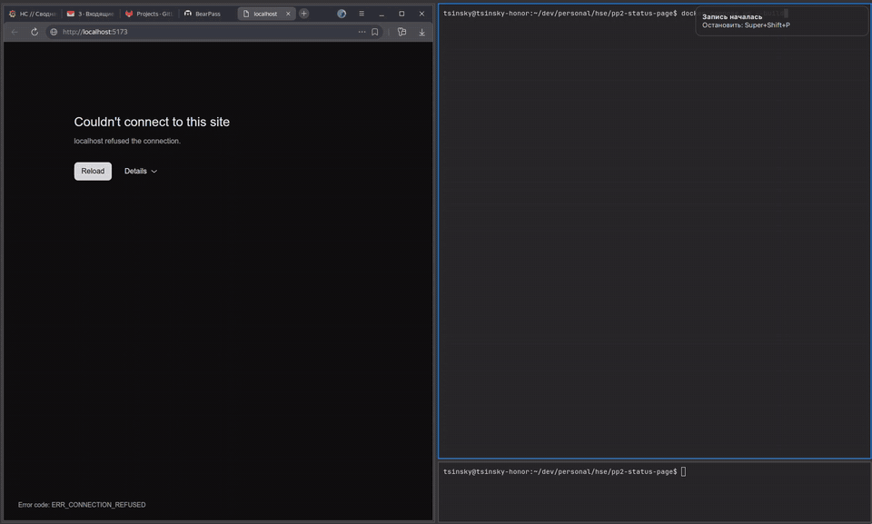
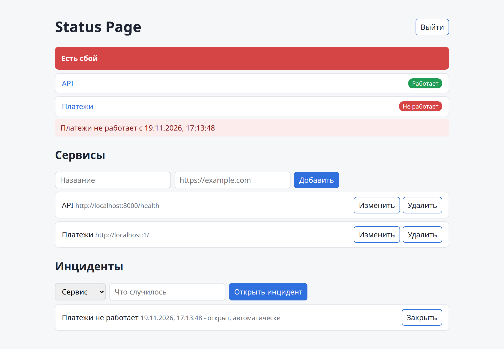
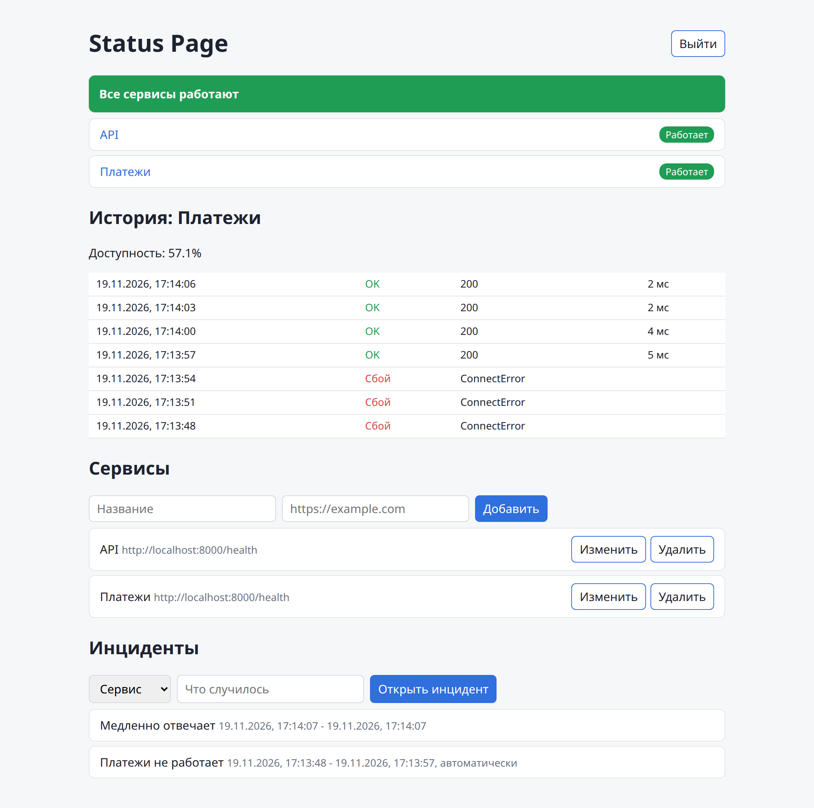
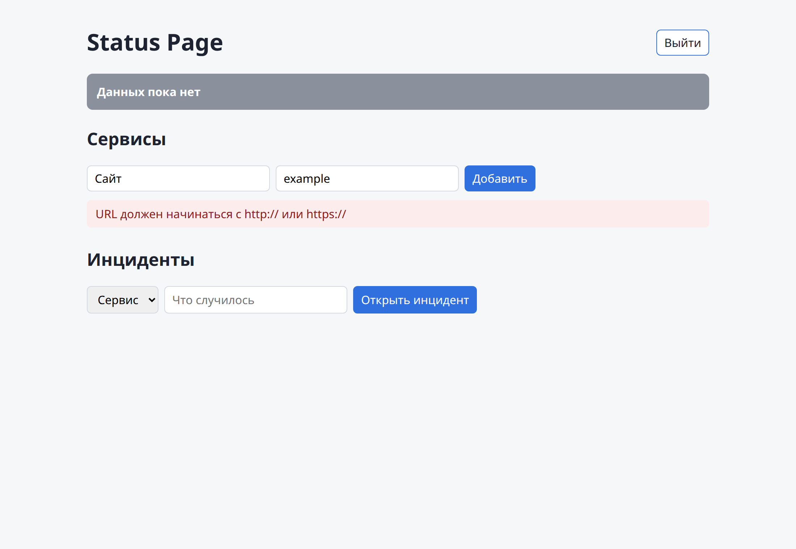
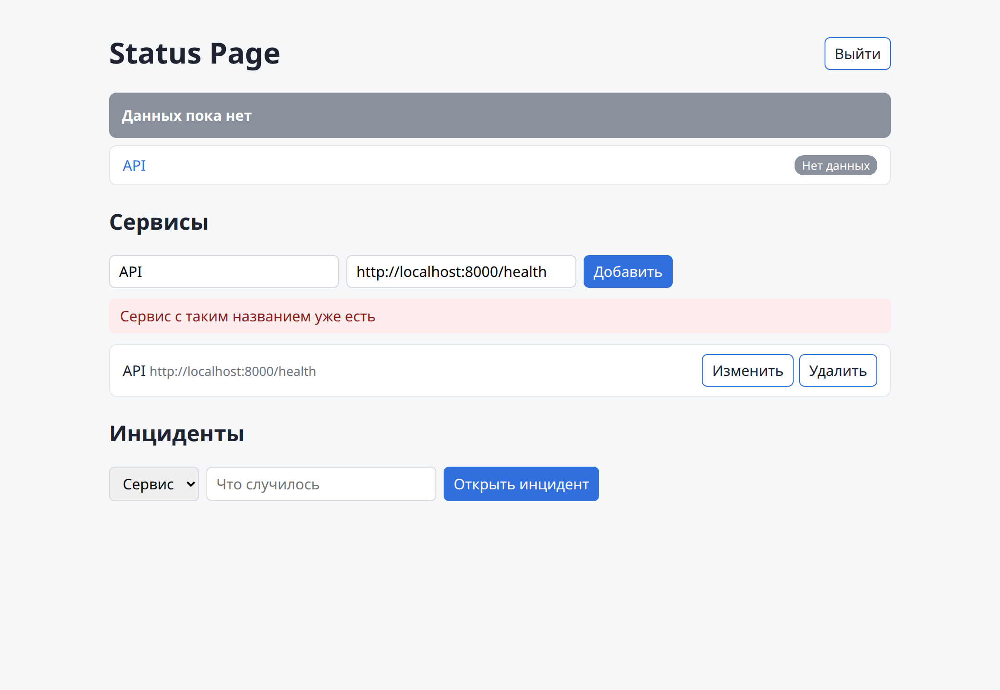
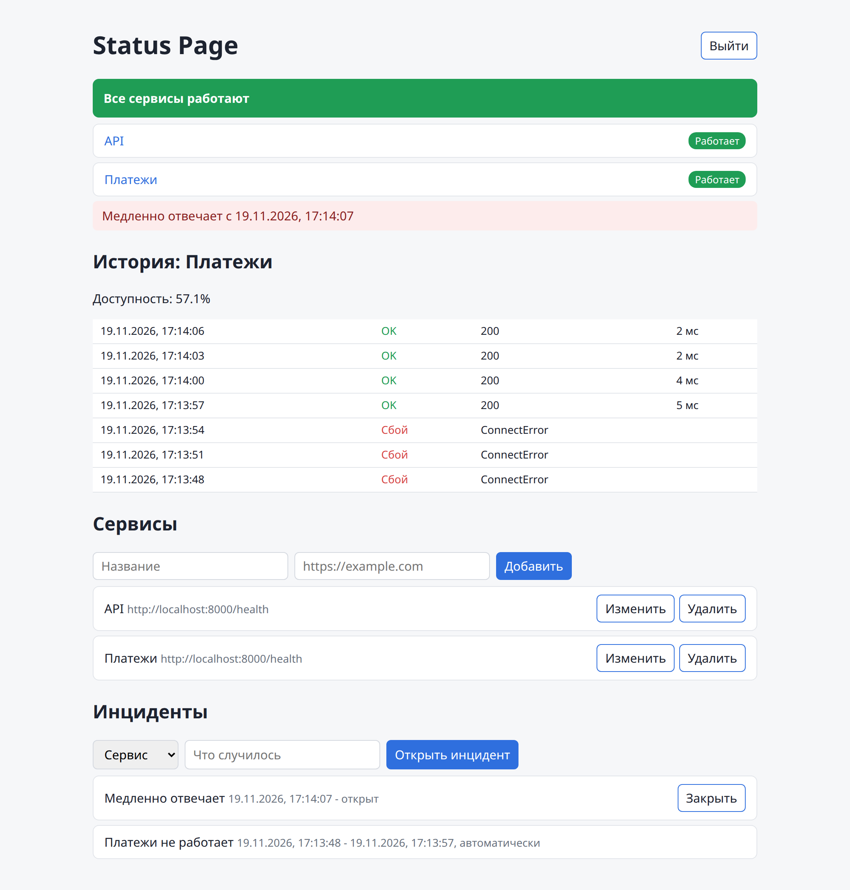

Репозиторий: https://github.com/Tsynskyy/pp2-status-page/tree/hw2

# Status Page

ДЗ 2: клиент на React

Приложение: страница статусов и инцидентов сервисов

Функциональные и нефункциональные требования: [REQUIREMENTS.md](REQUIREMENTS.md)

## Демо

Запись использования



## Запуск

```bash
API_TOKEN=$(openssl rand -hex 16) docker compose up --build
```

Клиент - http://localhost:5173

API - http://localhost:8000

описание OpenAPI - http://localhost:8000/docs

Для изменения данных необходимо ввести в панели значение `API_TOKEN`

Запуск клиента для разработки без Docker (Node.js 20+):
```bash
cd client
npm install
npm run dev
```

## Клиент

Клиент в `client/src/App.jsx`, запросы идут на `/api`

- Гость видит общий статус, статус каждого сервиса и открытые инциденты, страница обновляется каждые 10 секунд
- По клику на сервис показывается история последних 100 проверок и доступность
- Оператор входит по токену и изменяет данные
- Инциденты, которые сервер открыл сам, отмечены как "автоматически"

## Демонастрация

Автоматический инцидент: упавший сервис



История проверок, автоинцидентов



Проверка ввода



Ошибка сервера



Ручной инцидент



## API

| Запрос | Кто | Что делает |
|---|---|---|
| `GET /status` | все | общий статус, сервисы, открытые инциденты |
| `GET /services` | все | список сервисов |
| `POST /services` | только оператор | добавить сервис |
| `PUT /services/{id}` | только оператор | изменить сервис |
| `DELETE /services/{id}` | только оператор | удалить сервис |
| `GET /services/{id}/checks` | все | последние 100 проверок |
| `GET /incidents` | все | последние 100 инцидентов |
| `POST /incidents` | только оператор | открыть инцидент |
| `POST /incidents/{id}/close` | только оператор | закрыть инцидент |
| `GET /health` | все | healthcheck |
